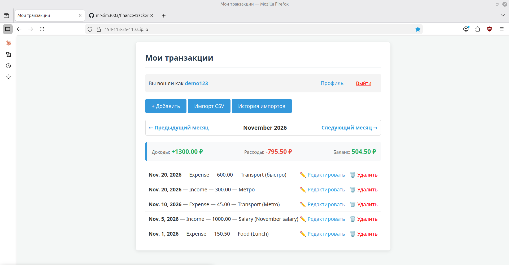
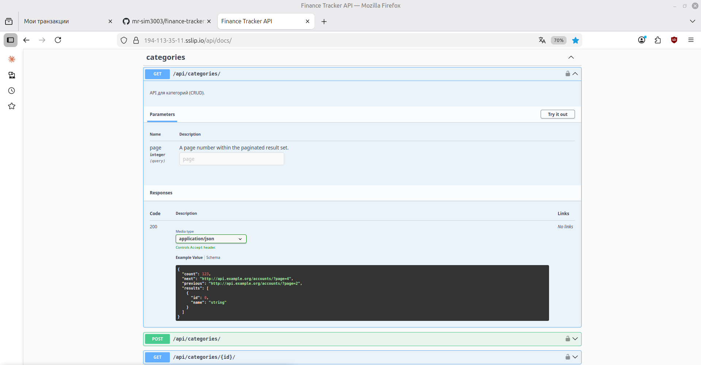

# Finance Tracker

Веб-приложение для учёта личных доходов и расходов: ручное добавление транзакций,
импорт банковских выписок в CSV (в фоне, с защитой от дублей), REST API и админ-панель.

[](https://github.com/mr-sim3003/finance-tracker/actions/workflows/ci.yml)


🔗 **Демо:** [https://194-113-35-11.sslip.io/](https://194-113-35-11.sslip.io/)
> **Для демонстрации:** логин `demo123`, пароль `z987654321`. Можно зайти и потыкать интерфейс и API.



## Стек

| Слой | Технологии |
|---|---|
| Backend | Python 3.12, Django 5.2, Django REST Framework |
| БД | PostgreSQL 15 |
| Асинхронность | Celery, Redis |
| Инфраструктура | Docker Compose, Nginx, Gunicorn |
| Тесты | pytest, pytest-django |
| CI | GitHub Actions (ruff, pytest) |

## Возможности

- **Аутентификация** — кастомная модель пользователя (`CustomUser`), доступ к данным только для авторизованных.
- **CRUD транзакций** — создание, редактирование, удаление; фильтрация по месяцу; агрегаты «доход / расход / баланс» за месяц.
- **Импорт CSV** — загрузка файла, обработка в фоне через Celery, история импортов. Идемпотентность: повторная загрузка того же файла не создаёт дублей.
- **REST API** — CRUD транзакций и категорий, OpenAPI-схема, Swagger UI и ReDoc.
- **Healthcheck** — `/healthz/` проверяет БД и Redis, возвращает 503 при деградации.
- **Изоляция данных** — защита от IDOR на уровне queryset: пользователь видит только свои объекты (views, DRF, история импортов).



## Архитектура и принятые решения


### Celery для импорта CSV
Файл может быть большим, а парсинг и запись в БД — долгими. Пользователь не должен ждать
ответа: view сохраняет файл, создаёт `ImportJob` со статусом `pending` и ставит задачу
в очередь. `ImportJob` создаётся **до** `task.delay()` — если Celery недоступен, запись
остаётся в истории, и пользователь видит, что импорт не начался.

### Идемпотентность импорта
Повторная загрузка того же файла не создаёт дублей. Два уровня защиты:
- `UniqueConstraint` на `(owner, date, amount, type, description)` в модели `Transaction`;
- ранний выход из задачи, если `job.status == "done"` (защита от ретрая Celery после успеха).

### Защита от IDOR
Везде, где выбираются объекты пользователя, используется `filter(owner=request.user)`:
в Django-views (`get_queryset`), в DRF-ViewSet'ах, в `ImportJobListView`. Пользователь
не может открыть, изменить или удалить чужую транзакцию даже по прямому ID — получит 404.

### Разделение view-слоя по доменам
`views.py` — CRUD транзакций, `imports.py` — импорт CSV, `health.py` — healthcheck.
Имя файла = контекст: открыл `imports.py` — сразу видишь всё про импорт, не листая
`views.py` на 300 строк.

### `DecimalField` для денег
Суммы хранятся в `DecimalField(max_digits=12, decimal_places=2)`, а не в `float` —
иначе копейки «плывут» при сложении. Валидация «сумма > 0» продублирована в форме,
DRF-сериализаторе и на уровне модели (через constraint).

### `default_storage` вместо `MEDIA_ROOT`
Файлы сохраняются через `django.core.files.storage.default_storage`. Локально это
`FileSystemStorage`, в облаке — `S3Storage`, без правок кода: достаточно поменять
`DEFAULT_FILE_STORAGE` в настройках.

## Быстрый старт (Docker)


Нужны Docker и Docker Compose.

```bash
git clone https://github.com/mr-sim3003/finance-tracker.git
cd finance-tracker
cp .env.example .env          # при необходимости поправь SECRET_KEY и ALLOWED_HOSTS
docker compose up -d --build
docker compose exec web python manage.py migrate
docker compose exec web python manage.py createsuperuser
```

Приложение: [http://localhost:8000/](http://localhost:8000/)
(локально Nginx отключён через `docker-compose.override.yml`, порт 8000 проброшен напрямую).

## Тесты

```bash
# внутри контейнера
docker compose exec web pytest

# локально (SQLite, Celery в eager-режиме)
pytest
```

Покрыто: регистрация и аутентификация, CRUD транзакций, изоляция данных (IDOR),
валидация сумм и категорий, идемпотентность импорта CSV, healthcheck.

## API

- Swagger UI: [`/api/docs/`](https://194-113-35-11.sslip.io/api/docs/)
- ReDoc: [`/api/redoc/`](https://194-113-35-11.sslip.io/api/redoc/)
- OpenAPI-схема: `/api/schema/`

Аутентификация — session-based (как в веб-интерфейсе). Все эндпоинты требуют логина;
есть throttling (`UserRateThrottle` / `AnonRateThrottle`).

## Деплой

Прод запущен на VPS: Docker Compose + Nginx (reverse proxy, TLS через Let's Encrypt) +
Gunicorn. Healthcheck контейнера `web` ходит на `/healthz/`, поэтому балансировщик и
Docker видят деградацию БД или Redis.

Конфиги: [`deploy/nginx.conf`](deploy/nginx.conf), [`deploy/gunicorn.conf.py`](deploy/gunicorn.conf.py).
Подробнее — в [DEPLOY.md](DEPLOY.md).

## Структура проекта

```text
.
├── accounts/         # кастомный пользователь, регистрация, профиль
├── config/           # настройки Django (base, local, prod, test), Celery
├── tracker/          # транзакции, категории, импорт CSV, DRF API, healthcheck
├── deploy/           # nginx.conf, gunicorn.conf.py
├── templates/        # HTML-шаблоны
├── static/           # CSS
├── docs/screenshots/ # скриншоты для README
├── docker-compose.yml
├── Dockerfile
└── requirements.txt
```

## Ограничения

Осознанные упрощения:

- **Идемпотентность импорта** основана на `UniqueConstraint` по
  `(owner, date, amount, type, description)`. Если у пользователя действительно две
  одинаковые транзакции в один день (например, два кофе по 150 ₽), вторая будет
  пропущена. Это компромисс: для учебного проекта важнее гарантия «нет дублей при
  повторном импорте», чем сохранение всех совпадений.
- **Нет токен-аутентификации** для внешних клиентов — API использует session auth.
  Для мобильного клиента или сторонней интеграции понадобился бы DRF Token / JWT.
- **Статус импорта не обновляется на фронте автоматически** — нужен polling или
  WebSocket, чтобы пользователь видел переход `pending → done` без перезагрузки.
- **Нет ограничения на размер CSV-файла** на уровне приложения (только
  `client_max_body_size 10M` в Nginx). Для больших выписок стоит добавить проверку
  в форме или стриминговый парсер.

## Лицензия

Учебный проект.
